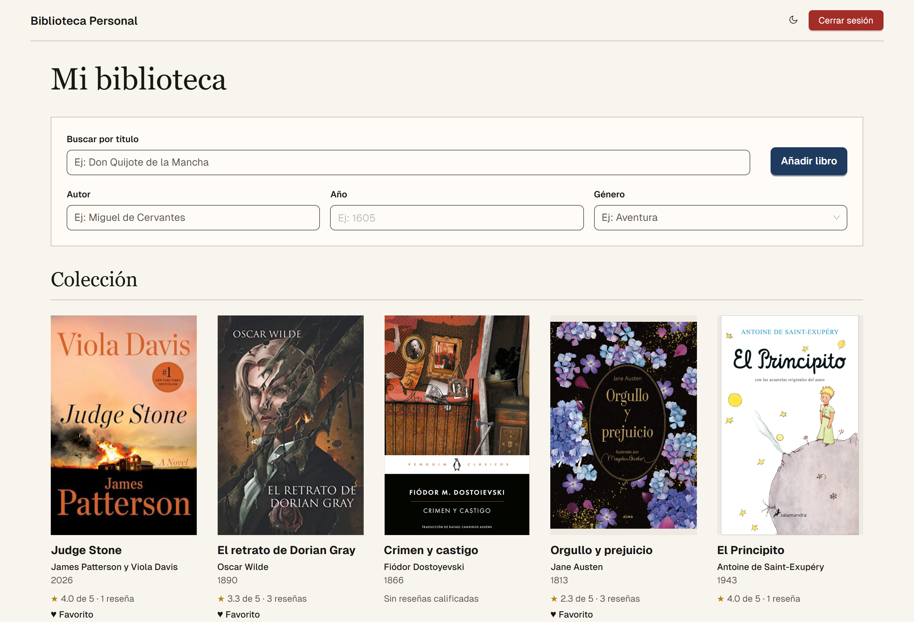
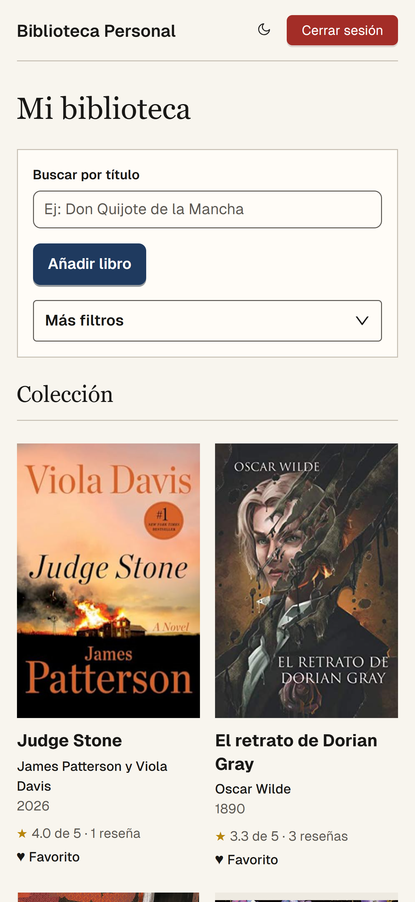
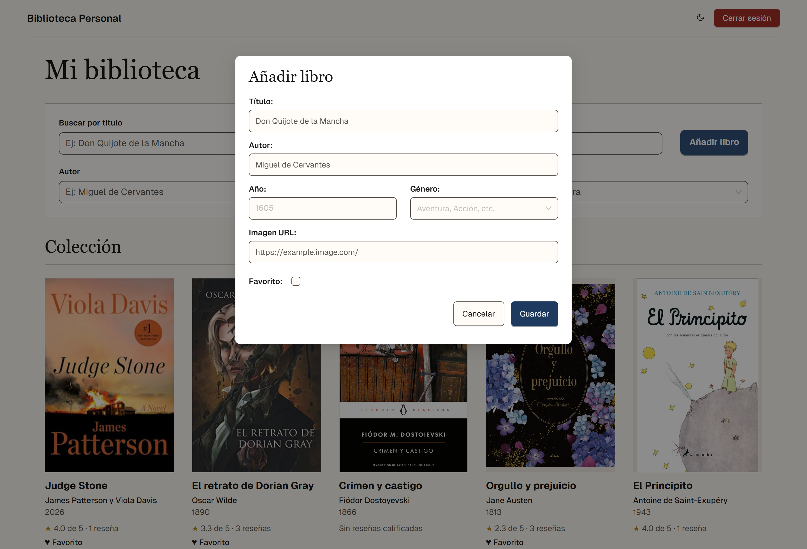
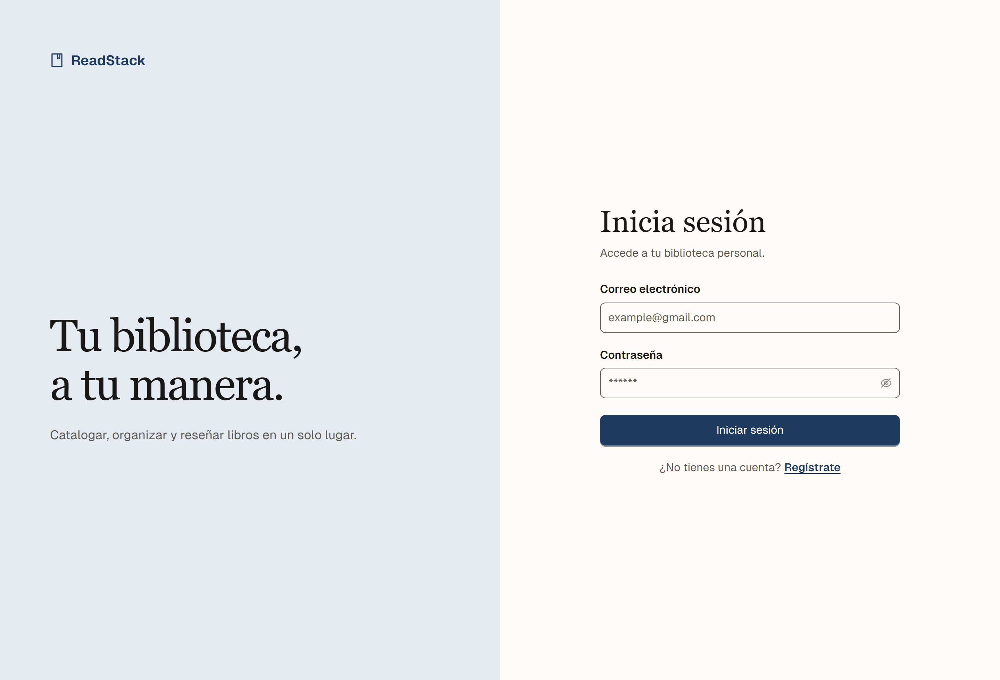

# ReadStack

ReadStack is a multiuser personal book catalog for organizing collections and recording reviews. Search and filter your library, keep track of favorites, and revisit your impressions of each book. It is a catalog, not an ebook reader.

## Screenshots

### Library



### Book detail


| Mobile library | Add a book | Sign in |
| --- | --- | --- |
|  |  |  |

## Features

- Public registration and sign-in, with a separate collection for each user.
- Add, view, edit, and delete books with details such as title, author, year, genres, and cover.
- Search by title, filter by author, year, and genre, and browse paginated results.
- Mark favorites and manage reviews and ratings on each book's detail page.
- Export an individual book to CSV; full-library export is not implemented.
- Responsive interface with light and dark themes; the browser stores the selected preference.

## Technology and architecture

- **Frontend:** Next.js 16.4.6 with App Router, React 19.3.1, and TypeScript. Ant Design 5.29.3 and Tailwind CSS 3 support the interface; client services communicate with the API.
- **Backend:** Node.js, Express 4, and TypeScript. The REST API is organized into routes, middleware, controllers, and models, with Zod input validation.
- **Data:** SQLite through `better-sqlite3` and parameterized SQL. Tables are created at startup; versioned migrations are not yet implemented.
- **Authentication and authorization:** bcrypt password hashing and JWT authentication. The frontend stores the token in a JavaScript-readable cookie and sends it as a Bearer token. The API verifies the token and checks book and review ownership; frontend navigation protection does not replace those checks.

## Design

The approved **Archival Modern** direction combines a restrained editorial style with prominent book covers, generous space, and responsive layouts. Light and dark themes receive equal care. Implementation and visual and accessibility validation are ongoing; see [DESIGN.md](DESIGN.md) for the design principles and their limits.

## Local setup

Local validation has used Node.js 22; npm 10 is recommended. Install dependencies separately for the frontend and backend. Use synthetic accounts and data for local work.

### Backend

From the repository root:

```bash
cd backend
npm install
npm run build
```

Configure the following environment variables for the backend process. The backend does not automatically load an `.env` file.

| Variable | Purpose |
| --- | --- |
| `SECRET_KEY` | Required. Use an independently generated local secret of exactly 64 hexadecimal characters. Do not publish it or store it in the repository. |
| `DATABASE_PATH` | SQLite path. Use an isolated local path for synthetic data; otherwise it defaults to `library.db` relative to the working directory. Avoid modifying the tracked `backend/library.db`. |
| `PORT` | API port; defaults to `3000`. Set it to `4000` for the frontend configuration below. |

With those variables configured, start the server from `backend/`:

```bash
npm start
```

With `PORT` set to `4000`, the API is available at `http://localhost:4000/api/v1`. See the [environment governance guide](docs/ENVIRONMENT_GOVERNANCE.md) for the full variable inventory, rate-limit options, and secret management. Keep secrets out of shell history and use distinct secrets for different environments; changing the signing key invalidates existing sessions.

Authentication rate limits are process-local, not distributed. Login and registration have per-account limits; the optional IP limit uses only the direct socket peer and is disabled by default. Enable it only after verifying that the direct peer is the actual client, not a proxy shared by clients. Render's ingress and client-IP behavior are unverified: do not enable this direct-peer limiter there on that assumption. A Render per-client limiter requires a separately verified, non-spoofable ingress/header trust boundary and a reviewed implementation; the current limiter deliberately ignores forwarded headers, even if Express proxy trust is enabled. Verify that clients cannot bypass the trusted ingress, how it sanitizes forwarding headers and identifies the client, and the correct trusted proxy configuration before designing such a change.

These limits do not stop attempts spread across many accounts, instances, or restarts. Registration currently reveals an existing email through its 409 response; changing that contract requires a separate decision. Unknown-user logins perform a dummy bcrypt comparison to reduce a timing signal, not guarantee constant-time responses; this extra synchronous work also increases the risk of CPU exhaustion under abuse.

### Frontend

In another terminal, from the repository root:

```bash
cd frontend
npm install
```

Create `frontend/.env.local` with the local API address:

```env
NEXT_PUBLIC_API_URL=http://localhost:4000/api/v1
```

Then start the development server:

```bash
npm run dev
```

Open `http://localhost:3000`. To build and serve an optimized local frontend, run `npm run build` and `npm run start` from `frontend/`.

## Tests

With dependencies installed, run these commands from the repository root in separate terminals:

```bash
cd frontend
npm test
npm run lint
```

```bash
cd backend
npm test
npm run test:security
```

Backend tests use synthetic data and isolated temporary SQLite databases. Local tests cover functionality and cross-user isolation, but CI and comprehensive browser validation remain pending.

## Project status

ReadStack is being modernized. Its features and tests exist locally, but that is not production approval. Comprehensive browser validation, security and deployment gates, CI, and decisions about sessions and persistence remain outstanding.

The current implementation uses SQLite. A PostgreSQL provider decision and the planned migration remain pending; no provider has been selected. A staging strategy has not been approved, and durable production persistence and recovery have not been verified. The modernization changes are not claimed as deployed or production-ready. See [PROGRESS.md](PROGRESS.md) and [PLAN.md](PLAN.md) for current status and pending decisions.

---

**Author:** José A. Mota · [Project repository](https://github.com/JoseAMota11/read-group-challenge)
